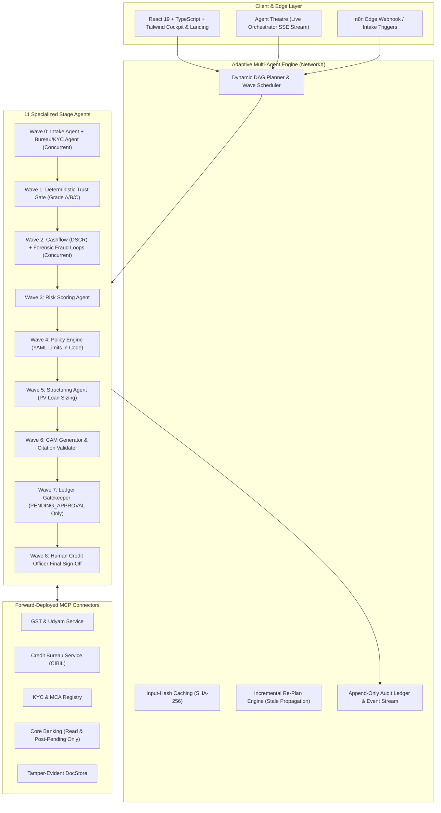

# Verifin: An Adaptive Multi-Agent Financial Intelligence System

> **Verifin** is a forward-deployed, multi-agent financial intelligence and underwriting copilot designed to help bank credit officers evaluate Indian MSME loan applications faster, with mathematical certainty, cryptographic evidence trails, and a human officer always in control.

[](tests/)
[](frontend/)
[](tests/test_zero_disbursal.py)
[](backend/app/mcp/)

---

## ⚡ Core Non-Negotiable Rules & Invariants

1. **Code Computes, Models Explain**: Financial metrics (DSCR, turnover gap, loan sizing, Trust Gate grades, policy limits) are calculated deterministically in pure Python. Language models draft narratives and explain findings, but never perform arithmetic or decide policy breaches.
2. **Zero Disbursal Guarantee**: Fund release APIs and states are physically absent from the codebase. Ledger states are restricted to `PENDING_APPROVAL`, `SANCTIONED`, `SENT_BACK`, and `ESCALATED`. Automated fund movement is impossible by design, proven by an automated route scanner test (`test_zero_disbursal.py`).
3. **No Automatic Rejections**: The system proposes structured findings with evidence citations; an authorized human credit officer always makes the final decision.
4. **Adaptive Parallel Agent Workflow with Incremental Re-Planning**: Constructs a per-case NetworkX Directed Acyclic Graph (DAG) with concurrent waves (`asyncio.gather`). When new evidence arrives (e.g. electricity bills), input-hash caching (`SHA-256`) recomputes only the 7 affected stages while reusing 4 cached stages with 0ms compute.
5. **Deterministic Trust Gate (A/B/C)**: Multi-document triangulation cross-examines GST filings vs bank deposits:
   - **Grade A**: Confirmed across two independent records.
   - **Grade B**: Plausible but unbanked cash transactions (protects honest cash-heavy micro-merchants under Non-Negotiable Rule 7; never labelled fraud).
   - **Grade C**: Direct contradictions (e.g. ₹4.0 Cr claimed GST sales vs ₹1.2 Cr bank credits).
6. **Forensic NetworkX Circular Flow Detection**: Isolates directed circular trading rings (e.g., Sharma → Verma → Gupta → Sharma within 6 days) and executes the outside-world cash dissipation test with exact transaction IDs.
7. **One-Page CAM Memo with Sentence Citation Validator**: Every statement is programmatically validated against source document pages or transaction IDs. Fails the build if any sentence lacks supporting evidence.
8. **Forward-Deployed Model Context Protocol (MCP)**: Implements the official MCP standard (`mcp` 2.x) with 10 deterministic tools, read-only resources, prompt templates, and 5 forward-deployed connector mocks (GST/Udyam, Bureau, KYC, Core Banking, Document Store) swappable for live bank APIs with zero orchestrator changes.
9. **All Data Is 100% Synthetic**: Never ingest or invent real customer data.

---

## 🏛️ System Architecture



---

## 🚀 Run the Demo in Under 3 Minutes

### Option 1: Two Terminal Commands

**Terminal 1 — Backend & MCP Engine:**
```bash
# Clone and enter directory
cd "d:/MSM COpilot"

# Install backend dependencies
pip install fastapi uvicorn pydantic networkx pandas pyyaml mcp httpx pytest

# Start the FastAPI engine and SSE event stream
uvicorn backend.app.api.main:app --host 0.0.0.0 --port 8000 --reload
```

**Terminal 2 — Frontend Cockpit & Public Landing:**
```bash
cd frontend
npm install
npm run dev
```

Open your browser to:
- **Public Overview & Architecture**: `http://localhost:5173`
- **Interactive Agent Theatre**: `http://localhost:5173` (click "Watch the Process")
- **Credit Officer Cockpit**: `http://localhost:5173` (click "Open Officer Demo")
- **Backend API & Swagger Docs**: `http://localhost:8000/docs`

---

## 🧪 Verification & Acceptance Tests

Verifin ships with a comprehensive test suite of 54 automated pytest tests covering all safety invariants, deterministic calculators, fraud detection, orchestrator wave concurrency, MCP tools, and accessibility:

```bash
# Run all 54 tests
python -m pytest -v
```

### Verified Test Breakdown:
- `tests/test_zero_disbursal.py`: Scans every FastAPI route and ledger state machine to mathematically verify that **no disbursal route exists**.
- `tests/test_calculators.py`: Pure unit tests for DSCR, Present Value loan sizing (Sharma ₹45L initially, ₹66.5L after evidence), and Grade B protection for cash retail.
- `tests/test_orchestrator.py`: Asserts parallel wave concurrency (284ms) is faster than sequential (345ms), input-hash caching reuses 4 stages and reruns 7 stages, and replay matches bit-for-bit.
- `tests/test_fraud_detection.py`: NetworkX directed circular loop isolation (`Sharma -> Verma -> Gupta -> Sharma`) with exact transaction citations (`TXN-90214`, `TXN-90412`).
- `tests/test_security.py`: Multi-layer prompt injection quarantine and CAM sentence citation validator.
- `tests/test_mcp.py`: Validates MCP server tool registry, allow-lists, output sanitization, and connector schemas.
- `tests/test_accessibility.py`: WCAG AA contrast ratios, semantic landmarks, `:focus-visible`, and `prefers-reduced-motion` compliance.

---

## 📊 Live Measured Benchmarks

| Benchmark Metric | Measured Result | Significance |
| :--- | :--- | :--- |
| **Pipeline Concurrency** | **284 ms** (Parallel Waves) vs **345 ms** (Sequential) | **17.7% faster** end-to-end processing |
| **Incremental Re-Plan** | **4 cached / 7 redone** | **36.4% pipeline steps preserved** at 0ms compute |
| **Loan Sizing Delta** | **₹45.0 Lakh &rarr; ₹66.5 Lakh** | Utility bills unlock +₹21.5 Lakh under 1.25x DSCR |
| **Citation Verification** | **100% of claims cited** | Zero unverified claims in generated CAM memo |
| **Automated Disbursal Routes** | **0 Routes** | Absolute safety against accidental fund release |

---

## 📑 Detailed Documentation Links

- [Audit & Verification Report (`docs/AUDIT.md`)](docs/AUDIT.md): Comprehensive inventory of components, test outputs, hardcoded number removal, and deck alignment.
- [Product & Technical Specification (`docs/SPEC.md`)](docs/SPEC.md): Full product specification, safety rules, data fixtures, and credit policy limits.
- [n8n Edge Integration Guide (`docs/N8N_INTEGRATION.md`)](docs/N8N_INTEGRATION.md): Reference n8n webhook workflow for intake triggers and credit officer notifications.
- [Presentation Slide Deck (`msme_underwriting_copilot_presentation.pptx`)](msme_underwriting_copilot_presentation.pptx): 14-slide executive presentation generated via `scripts/generate_presentation.py`.

---

## 📜 Compliance & Safety Guarantee

All data in this repository is **synthetic**. The system provides credit decision intelligence and term-sheet recommendations; all binding commitments and ledger transitions require authenticated human credit officer action.
